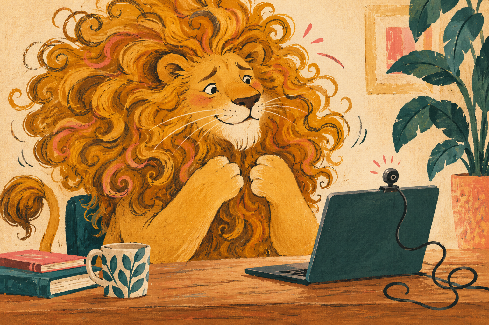

# The blog lion

Kathleen chose this lion as the recurring character for the blog on October 27, 2026.
Use him in each new blog illustration, including images added to older posts.

## The reference

`reference.png` is the full-size original image that Kathleen approved.
Keep this file as the fixed reference for his identity and the art style.
The first published image is `/public/images/writing/where-does-confidence-come-from.webp`.
The other post scenes and their prompts are in [post-images.json](post-images.json).

Read the post before you choose the scene.
Inspect `reference.png` before you generate an image.
Use the built-in imagegen tool with this file in `referenced_image_paths`.
Use the reference for every image, even when the pose or setting changes.
Do not rely on a text prompt alone to preserve his face.

## Keep these traits

- A golden-ochre lion with an oversized, flowing mane of loose curls and ringlets.
- A soft, rounded face with a cream muzzle and chin.
- A broad dark nose, fine white whiskers, and expressive eyes with white sclera and dark pupils.
- Rounded ears inside the mane, warm cheeks, and gentle curved eyebrows.
- A sturdy golden body, large soft forepaws, and a curling tail with a tuft when visible.
- Loose dark pencil lines, dry gouache marks, cut-paper shapes, and visible paper grain.
- Warm paper, deep teal, marigold, and small coral-pink accents.

His mood can change with the post.
He can feel brave, curious, puzzled, calm, delighted, or nervous.
The first image shows nerves about a webcam.
That mood is part of that scene, not a permanent trait.
Change his pose, action, props, and setting to fit the writing.
Keep his face, mane, proportions, and painted texture consistent.

## Reusable prompt

Use this identity paragraph in each prompt:

> Use the attached approved image as the identity and style reference for the same recurring golden lion. Preserve his soft rounded face, cream muzzle and chin, broad dark nose, fine white whiskers, expressive eyes with white sclera and dark pupils, rounded ears, warm cheeks, and enormous flowing mane of loose ochre curls and ringlets. Keep his sturdy body and large soft forepaws. Preserve the loose dark pencil outlines, dry gouache texture, cut-paper shapes, and warm visible paper grain. Use warm paper, deep teal, marigold, and small coral-pink accents. He should feel warm, witty, and expressive, like a drawing in an adult personal notebook.

Then add the post's subject, one clear visual joke or idea, his action, and his mood.
Use a wide 3:2 frame unless the placement needs another shape.
Keep his face and the main action inside the central 80 percent.
Do not add words, logos, watermarks, or extra characters unless the post needs them.
Do not change him into a glossy 3D mascot, a corporate stock character, or a photoreal lion.

## Check each result

Compare the new image with `reference.png` before you publish it.
Check his face, mane, colors, proportions, and texture.
Check that the scene fits the post and works at the page's image size.
If his identity changes, correct the image with the original reference.
Save the finished web image in `public/images/writing/` with the post's slug.
Add clear alt text that describes the scene.
